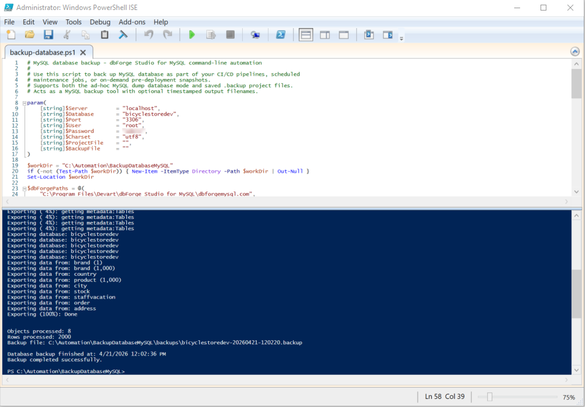

# Database backup

This PowerShell script creates a MySQL database backup using the command-line interface of [dbForge Studio for MySQL](https://www.devart.com/dbforge/mysql/studio/).

## [backup-database.ps1](backup-database.ps1)

This script serves as a complete MySQL backup tool that creates a full dump of a MySQL database. It supports the following two modes:

- **Project mode** — uses a saved `.backup` project file from dbForge Studio with pre-configured settings. This mode is ideal for scheduled MySQL database backup jobs in CI/CD pipelines.
- **Ad-hoc mode** — creates a MySQL database dump directly from command-line parameters. The output filename is auto-generated with a timestamp: `<database>-YYYYMMDD-HHmmss.sql` (dbForge creates a SQL dump and appends `.sql` to any other file extension, e.g. `mydb.backup` is saved as `mydb.backup.sql`).

Use this script as your MySQL database backup tool to automate pre-deployment snapshots, nightly MySQL backup software routines, or on-demand copies before risky migrations.

## Typical use cases

Automated MySQL database backups guarantee the recoverability, integrity, and continuity of your application. Scripted database backups can be integrated into routine operations serving multiple purposes:
- Disaster recovery
- Human error prevention
- Auditing and compliance
- Data migration and environment upgrades
- Data security
- Continuous operations and availability maintenance

## Parameters

| Parameter | Default | Description |
|-----------|---------|-------------|
| `$Server` | `localhost` | MySQL server host |
| `$Database` | `bicyclestoredev` | Database to back up |
| `$Port` | `3306` | MySQL server port (MySQL default port is `3306`) |
| `$User` | `root` | Login user |
| `$Password` | *(empty)* | Login password |
| `$Charset` | `utf8` | Connection character set |
| `$ProjectFile` | *(empty)* | Path to a `.backup` project file (optional) |
| `$BackupFile` | *(auto)* | Output backup file path; auto-generated if not provided |

## How to use

```powershell
# Ad-hoc backup with an auto-generated filename
.\backup-database.ps1 -Server "prod-host" -Database "mydb" -Password "secret"

# Backup to a specific file
.\backup-database.ps1 -Database "mydb" -BackupFile "C:\backups\mydb-manual.sql"

# Backup using a saved project file
.\backup-database.ps1 -ProjectFile "C:\projects\mydb.backup" -Database "mydb"
```

## Exit codes

A successful script execution returns an exit code indicating success and is accompanied by a message describing the result. If the script fails, it returns an exit code indicating failure, and the accompanying message starts with "ERROR".

| Code | Meaning |
|------|---------|
| `0` | MySQL database backup completed successfully. |
| `10` | Command-line usage error. |
| `11` | Illegal argument duplication. |
| `12` | Unsatisfied dependency. |
| `20` | Trial expired. |
| `40` | Server connection failed. |
| `105` | Resource unavailable. |



## Requirements

- [dbForge Studio for MySQL](https://www.devart.com/dbforge/mysql/studio/) installed
- PowerShell 5.1 or later

**Ensure the integrity, consistency, and security of your databases with regular automated backups.**
