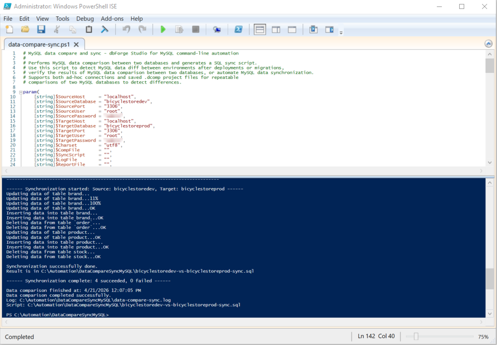

# Data comparison and synchronization

This PowerShell script is designed for data comparison and synchronization between two MySQL databases using the command-line interface of dbForge Studio for MySQL.

## [data-compare-sync.ps1](data-compare-sync.ps1)

The script performs a row-level MySQL data comparison between the source and target databases, detecting all INSERT, UPDATE, and DELETE differences, and generates a SQL script to resolve them. This is a comprehensive MySQL data comparison tool for detecting and fixing data drift between environments.

The script supports two modes:

- **Ad-hoc mode** — connects using parameters and allows you to compare two MySQL databases for differences on the fly.
- **Project mode** — loads a saved `.dcomp` project file with pre-configured table mappings and comparison settings.

The script can also produce a MySQL database comparison report in the HTML, CSV, or Excel format, listing all differences found.

## Typical use cases

Automated MySQL data diff detection and database synchronization supports you in multiple cases:

- MySQL data synchronization between dev/staging and production environments
- Data migration validation
- Detection of unintended data changes after a deployment
- Generation of a MySQL data diff report for audit purposes

## Parameters

| Parameter | Default | Description |
|-----------|---------|-------------|
| `$SourceHost` | `localhost` | Source server host |
| `$SourceDatabase` | `bicyclestoredev` | Source database |
| `$SourcePort` | `3306` | Source server port |
| `$SourceUser` | `root` | Source login user |
| `$SourcePassword` | *(empty)* | Source login password |
| `$TargetHost` | `localhost` | Target server host |
| `$TargetDatabase` | `bicyclestoreprod` | Target database |
| `$TargetPort` | `3306` | Target server port |
| `$TargetUser` | `root` | Target login user |
| `$TargetPassword` | *(empty)* | Target login password |
| `$Charset` | `utf8` | Connection character set |
| `$CompFile` | *(empty)* | Path to a `.dcomp` project file (optional) |
| `$SyncScript` | *(auto)* | Output SQL sync script; auto-named if not set |
| `$LogFile` | *(auto)* | Path to the log file |
| `$ReportFile` | *(empty)* | Optional report output path |
| `$ReportFormat` | `HTML` | Report format: `HTML`, `XLS`, or `CSV` |
| `$Force` | `false` | Apply synchronization immediately |
| `$ExecuteScript` | `false` | Execute the synchronization script; the target database is backed up immediately before execution. The old name `-ExecuteSync` is also accepted. |
| `$ExecuteHost` | *(empty)* | Server host against which the synchronization script is to be executed, if different from the target server host. When empty, the target server host is used. |
| `$ExecuteDatabase` | *(empty)* | Database to apply the synchronization script to, if different from the target database. When empty, the target database is used. |
| `$ExecutePort` | *(empty)* | Server port to be used during the synchronization script execution, if different from the target server port. When empty, the target server port is used. |
| `$ExecuteUser` | *(empty)* | Login user for the synchronization script execution, if different from the target login user. May be useful when different privileges are required for synchronization. When empty, the target login user is used. |
| `$ExecutePassword` | *(empty)* | Login password for the `$ExecuteUser`. When empty, the target password is used. |
| `$ExecuteCharset` | *(empty)* | Synchronization character set to be used in the synchronization script execution. When empty, the default character set is used. |

## How to use

```powershell
# Basic MySQL data comparison between two databases
.\data-compare-sync.ps1 -SourceDatabase "mydb_dev" -TargetDatabase "mydb_prod"

# With an HTML report of MySQL data diffs
.\data-compare-sync.ps1 -SourceDatabase "mydb_dev" -TargetDatabase "mydb_prod" `
    -ReportFile "C:\reports\data-diff.html"

# Using a saved .dcomp project (MySQL synchronization tool workflow)
.\data-compare-sync.ps1 -CompFile "C:\projects\mydb-data.dcomp" -Force
```

## Output

| Artifact | Description |
|----------|-------------|
| Log file | Detailed operation log |
| Sync script | SQL script used to apply data changes to the target database |
| Report | Comparison report (when `$ReportFile` is specified) |
| Backup | Pre-sync backup of the target database (`backup-<database>-<timestamp>.sql` in `C:\Automation\DataCompareSyncMySQL`); the backup is made only with `-ExecuteScript $true`, immediately before the sync script is executed. |

## Exit codes

A successful script execution returns an exit code indicating success and is accompanied by a message describing the result. If the script fails, it returns an exit code indicating failure, and the accompanying message starts with "ERROR".

| Code | Meaning |
|------|---------|
| `0` | Data differences found and the sync script generated (with `-Force`: synchronization applied). |
| `2` | Ctrl+Break. |
| `10` | Command-line usage error. |
| `11` | Illegal argument duplication. |
| `20` | Trial version expired. |
| `30` | Project file corrupted. |
| `40` | Server connection failed. |
| `100` | Data is identical. |
| `101` | Data differences found (returned by dbForge only when no synchronization is requested). |
| `105` | Resource unavailable. |
| `106` | I/O error. |
| `107` | Report generation failed. |
| `108` | No objects selected for comparison. |
| `112` | No objects available for synchronization. |



## Requirements

- [dbForge Studio for MySQL](https://www.devart.com/dbforge/mysql/studio/) installed
- PowerShell 5.1 or later

**Keep track of all your database changes with automated MySQL data comparison and synchronization.**
