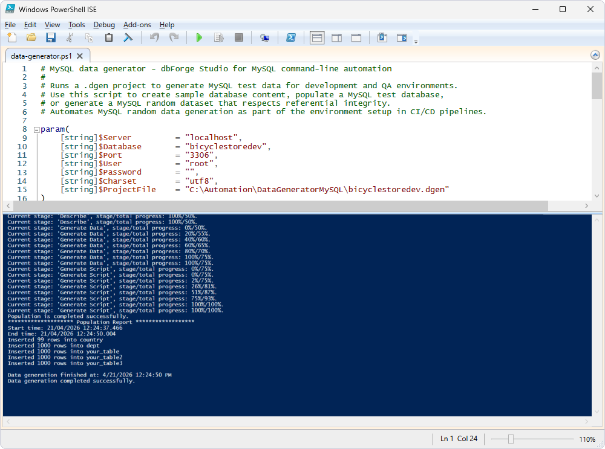

# MySQL data generator

This PowerShell script is intended for generating test data in a MySQL database using the command-line interface of [dbForge Studio for MySQL](https://www.devart.com/dbforge/mysql/studio/).

## [data-generator.ps1](data-generator.ps1)

The script executes a MySQL data generator project (`.dgen` file) to populate database tables with realistic dummy data. The `.dgen` file is configured in dbForge Studio and defines the generation rules for each column—data types, value ranges, patterns, foreign key relationships, and row counts.

The connection is passed in the script parameters, so the same project file can populate a database on any server.

## Typical use cases

The ability to automatically generate random MySQL data can be useful in various practical cases:

- Creation of sample database content for development and QA environments
- Population of a MySQL test database with meaningful, schema-consistent data
- Generation of a MySQL sample database for demos, training, or documentation
- Automated generation of MySQL test data as part of environment setup in CI/CD pipelines
- Creation of a realistic MySQL random dataset that respects referential integrity

## Parameters

| Parameter | Default | Description |
|-----------|---------|-------------|
| `$Server` | `localhost` | MySQL server host |
| `$Database` | `bicyclestoredev` | Name of the database to populate |
| `$Port` | `3306` | MySQL server port |
| `$User` | `root` | Login user |
| `$Password` | *(empty)* | Login password |
| `$Charset` | `utf8` | Connection character set |
| `$ProjectFile` | `C:\Automation\DataGeneratorMySQL\bicyclestoredev.dgen` | Path to the `.dgen` project file |

## How to use

```powershell
# Generate test data using the default project file
.\data-generator.ps1

# Generate test data on a remote, password-protected server
.\data-generator.ps1 -Server "dev-server" -Database "mydb" -Password "secret" `
    -ProjectFile "C:\projects\mydb.dgen"
```

## Exit codes

A successful script execution returns an exit code indicating success and is accompanied by a message describing the result. If the script fails, it returns an exit code indicating failure, and the accompanying message starts with "ERROR".

| Code | Meaning |
|------|---------|
| `0` | MySQL test data generation completed successfully. |
| `2` | Ctrl+Break. |
| `10` | Command-line usage error. |
| `11` | Illegal argument duplication. |
| `12` | Unsatisfied dependency. |
| `20` | Trial version expired. |
| `30` | Project file not found or corrupted. |
| `40` | Server connection failed. |
| `103` | Script executed with errors. |
| `105` | Resource unavailable. |
| `108` | No objects available for data generation. |



## Requirements

- [dbForge Studio for MySQL](https://www.devart.com/dbforge/mysql/studio/) installed
- PowerShell 5.1 or later

**Develop, test, and document your applications with meaningful data created using the MySQL random data generator.**
