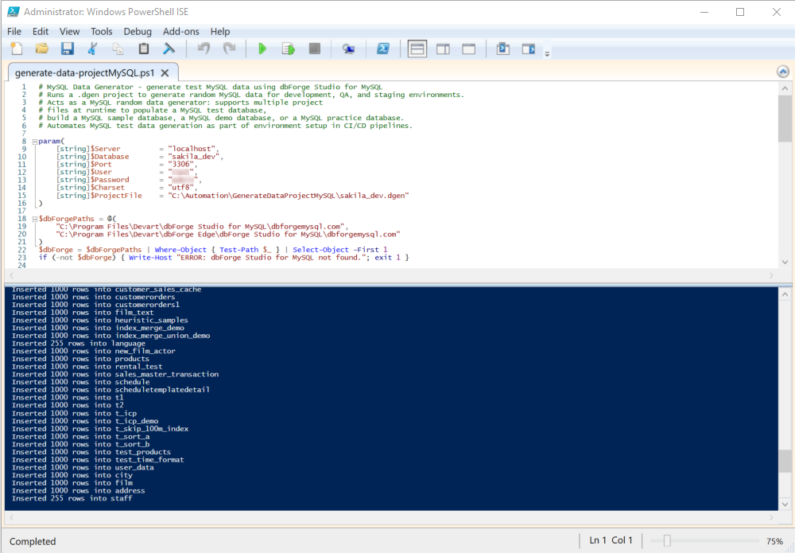

# Data generator from a project file

This PowerShell script is designed to generate test MySQL data using a project file and the command-line interface of [dbForge Studio for MySQL](https://www.devart.com/dbforge/mysql/studio/).

## [generate-data-project.ps1](generate-data-project.ps1)

The script runs a `.dgen` project file against a MySQL database to generate test data. The project file contains pre-configured MySQL random data generator rules—value ranges, patterns, row counts, and referential integrity settings—created in dbForge Studio.

This data generator for MySQL accepts the project file as a parameter at runtime, making it suitable for pipelines that manage multiple `.dgen` projects and select one dynamically. The connection credentials are passed separately, so a single project file can target different environments.

## Typical use cases

The ability to generate MySQL test data can be useful in a range of scenarios:

- Generation of random test MySQL data for development, QA, and staging environments
- Resetting of a MySQL test database to a known, populated state before test runs
- Creation of sample MySQL databases for demo, training, or documentation purposes
- Automated dataset creation in CI/CD pipelines

## Parameters

| Parameter | Default | Description |
|-----------|---------|-------------|
| `$Server` | `localhost` | MySQL server host |
| `$Database` | `sakila_dev` | Target database to populate |
| `$Port` | `3306` | MySQL server port |
| `$User` | `root` | Login user |
| `$Password` | *(empty)* | Login password |
| `$Charset` | `utf8` | Connection character set |
| `$ProjectFile` | `C:\Automation\GenerateDataProjectMySQL\sakila_dev.dgen` | Path to the `.dgen` project file |

## How to use

```powershell
# Generate test data using the default project file
.\generate-data-project.ps1

# Generate data into a specific database on a remote server
.\generate-data-project.ps1 -Server "dev-server" -Database "sakila_test" `
    -ProjectFile "C:\projects\sakila.dgen" -Password "secret"

# Override the target database (e.g., run the same project against a fresh environment)
.\generate-data-project.ps1 -Database "sakila_qa" `
    -ProjectFile "C:\Automation\GenerateDataProjectMySQL\sakila_dev.dgen"
```

## Exit codes

A successful script execution returns an exit code indicating success and is accompanied by a message describing the result. If the script fails, it returns an exit code indicating failure, and the accompanying message starts with "ERROR".

| Code | Meaning |
|------|---------|
| `0` | Test MySQL data generation completed successfully. |
| `2` | Ctrl+Break. |
| `10` | Command-line usage error. |
| `11` | Illegal argument duplication. |
| `12` | Unsatisfied dependency. |
| `20` | Trial version expired. |
| `30` | Project file not found or corrupted. |
| `40` | Server connection failed. |
| `103` | Script executed with errors. |
| `105` | Resource unavailable. |
| `108` | No objects available for data generation. |



## Requirements

- [dbForge Studio for MySQL](https://www.devart.com/dbforge/mysql/studio/) installed
- PowerShell 5.1 or later

**Populate your databases with realistic sample data using dbForge Studio for MySQL.**
