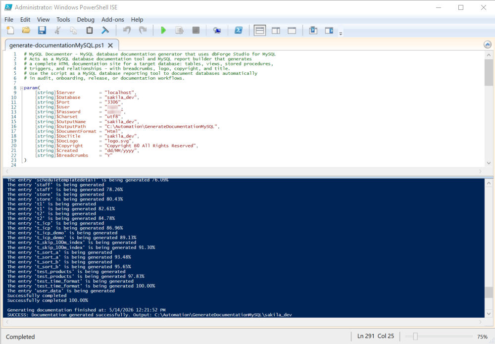

# Documenter

This PowerShell script generates MySQL database documentation using the command-line interface of [dbForge Studio for MySQL](https://www.devart.com/dbforge/mysql/studio/).

## [generate-documentation.ps1](generate-documentation.ps1)

This script acts as a MySQL database documentation generator that connects to a MySQL database and produces complete database documentation—tables, columns, indexes, foreign keys, views, stored procedures, triggers, and relationships—with breadcrumbs, a logo, a copyright notice, and a custom title. Supported formats include Markdown, HTML, and PDF.

This MySQL database documentation tool doubles as a MySQL report builder, generating a ready-to-publish static site saved to a local directory. Use it as a MySQL database reporting tool to document database content automatically as part of release or maintenance workflows.

## Typical use cases

MySQL database documentation generation is required in many database management workflows:

- Automatic generation of up-to-date MySQL database documentation as part of CI/CD
- Schema documentation production for audit, onboarding, or handover purposes
- Scheduled regular documentation refreshes to keep team references up-to-date

## Parameters

| Parameter | Default | Description |
|-----------|---------|-------------|
| `$Server` | `localhost` | MySQL server host |
| `$Database` | `sakila_dev` | Database to document |
| `$Port` | `3306` | MySQL server port |
| `$User` | `root` | Login user |
| `$Password` | *(empty)* | Login password |
| `$Charset` | `utf8` | Connection character set |
| `$OutputName` | `sakila_dev` | Output file/folder name |
| `$OutputPath` | `C:\Automation\GenerateDocumentationMySQL` | Directory for generated documentation |
| `$DocumentFormat` | `HTML` | Documentation format (`HTML`, `PDF`, `Markdown` ) |
| `$DocTitle` | `sakila_dev` | Title shown in the documentation |
| `$DocLogo` | `logo.svg` | Path to the logo file |
| `$Copyright` | `Copyright © All Rights Reserved` | Copyright text in the footer |
| `$Created` | `dd/MM/yyyy` | Date format for the "Created" field |
| `$Breadcrumbs` | `Y` | Show breadcrumb navigation (`Y` / `N`) |

## How to use

```powershell
# Generate HTML documentation for the default sakila_dev database
.\generate-documentation.ps1

# Document a different database with a custom title and output path
.\generate-documentation.ps1 -Database "myapp_prod" -DocTitle "MyApp Production" `
    -OutputPath "C:\Docs\myapp" -OutputName "myapp_prod"

# Generate documentation for a remote server with authentication
.\generate-documentation.ps1 -Server "prod-server" -Database "sakila_dev" `
    -Password "secret" -OutputPath "C:\Docs\sakila"
```

## Exit codes

A successful script execution returns an exit code indicating success and is accompanied by a message describing the result. If the script fails, it returns an exit code indicating failure, and the accompanying message starts with "ERROR".

| Code | Meaning |
|------|---------|
| `0` | Documentation generated successfully. |
| `2` | Ctrl+Break. |
| `10` | Command-line usage error. |
| `11` | Illegal argument duplication. |
| `12` | Unsatisfied dependency. |
| `15` | Invalid argument value. |
| `20` | Trial version expired. |
| `30` | Project file corrupted. |
| `40` | Server connection failed. |
| `105` | Resource unavailable. |
| `108` | No objects available for documentation. |



## Requirements

- [dbForge Studio for MySQL](https://www.devart.com/dbforge/mysql/studio/) installed
- PowerShell 5.1 or later

**Maintain your database documentation up to date with MySQL Documenter available in dbForge Studio.**
