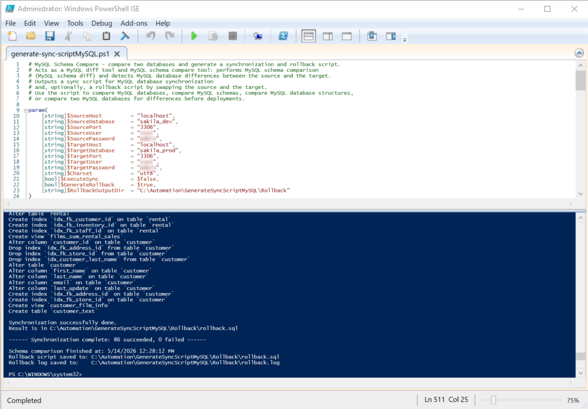

# Database schema comparison and synchronization

This PowerShell script is intended for MySQL schema comparison and synchronization script generation using the command-line interface of [dbForge Studio for MySQL](https://www.devart.com/dbforge/mysql/studio/).

## [generate-sync-script.ps1](generate-sync-script.ps1)

This script compares two MySQL database schemas and generates a SQL synchronization script to bring the target in line with the source. It also allows for tracking MySQL schema differences between environments.

Optionally, the script generates a rollback script by reversing the source and the target, enabling both forward deployments and safe rollbacks.

The script follows a safe two-phase deployment workflow:

1. **Compare** — performs a MySQL schema comparison to detect all differences between the source and the target
2. **Generate** — writes a sync script and, optionally, a rollback script to the disk
3. **Review** — allows you to inspect the scripts before applying
4. **Apply** (optional) — runs the sync script against the target using `-ExecuteSync $true`

## Typical use cases

Automated MySQL schema comparison and synchronization facilitate multiple tasks:

- Comparison of MySQL schemas before a release
- Detection of schema differences between environments
- Comparison of MySQL schema structures to detect drift in tables, indexes, views, and stored procedures
- Generation of deployment scripts for safe MySQL database synchronization
- MySQL schema comparison in a CI/CD deployment pipeline

## Parameters

| Parameter | Default | Description |
|-----------|---------|-------------|
| `$SourceHost` | `localhost` | Source server host |
| `$SourceDatabase` | `sakila_dev` | Source (reference) database |
| `$SourcePort` | `3306` | Source server port |
| `$SourceUser` | `root` | Source login user |
| `$SourcePassword` | *(empty)* | Source login password |
| `$TargetHost` | `localhost` | Target server host |
| `$TargetDatabase` | `sakila_prod` | Target database to sync |
| `$TargetPort` | `3306` | Target server port |
| `$TargetUser` | `root` | Target login user |
| `$TargetPassword` | *(empty)* | Target login password |
| `$Charset` | `utf8` | Connection character set |
| `$ExecuteSync` | `false` | Execute the sync script after generation |
| `$GenerateRollback` | `true` | Generate a rollback script (swaps source/target) |
| `$RollbackOutputDir` | `C:\Automation\GenerateSyncScriptMySQL\Rollback` | Directory for the rollback script and log |

## How to use

```powershell
# Generate a sync script for sakila_dev → sakila_prod (rollback included by default)
.\generate-sync-script.ps1

# Generate and execute immediately
.\generate-sync-script.ps1 -ExecuteSync $true

# Skip rollback script generation
.\generate-sync-script.ps1 -GenerateRollback $false

# Cross-server schema comparison and sync
.\generate-sync-script.ps1 `
    -SourceHost "dev-server"  -SourceDatabase "sakila_dev"  -SourcePassword "devpass" `
    -TargetHost "prod-server" -TargetDatabase "sakila_prod" -TargetPassword "prodpass"
```

## Exit codes

A successful script execution returns an exit code indicating success and is accompanied by a message describing the result. If the script fails, it returns an exit code indicating failure, and the accompanying message starts with "ERROR".

| Code | Meaning |
|------|---------|
| `0` | Schema differences found and the sync script generated successfully. |
| `2` | Ctrl+Break. |
| `10` | Command-line usage error. |
| `11` | Illegal argument duplication. |
| `20` | Trial version expired. |
| `30` | Project file corrupted. |
| `40` | Server connection failed. |
| `100` | Schemas are identical, no sync needed. |
| `101` | Schema differences found (returned by dbForge only when no sync script is requested). |
| `105` | Resource unavailable. |
| `106` | I/O error. |
| `107` | Report creation failed. |
| `108` | No objects selected for comparison. |
| `112` | No objects available for synchronization. |
| `114` | Error reading object filters file. |



## Requirements

- [dbForge Studio for MySQL](https://www.devart.com/dbforge/mysql/studio/) installed
- PowerShell 5.1 or later

**Stay on top of database structure changes with an advanced MySQL schema comparison tool available in dbForge Studio.**
