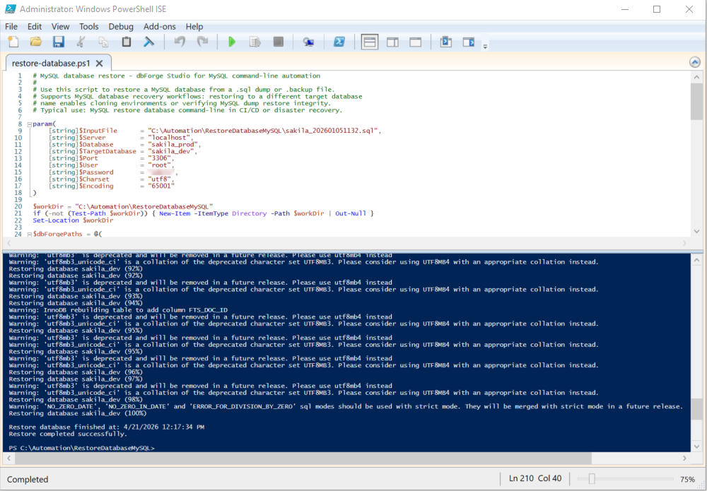

# Database restore

This PowerShell script is intended to restore a MySQL database from a backup or SQL dump file using the command-line interface of [dbForge Studio for MySQL](https://www.devart.com/dbforge/mysql/studio/).

## [restore-database.ps1](restore-database.ps1)

The script restores a MySQL database from a `.sql` or `.backup` file by loading the stored backup into a target MySQL database. It supports redirecting the recovery to a database name other than the one stored in the backup, making it useful for cloning or migrating data between environments.

## Typical use cases

A script that automates database recovery from a backup file can be useful in a variety of use cases:

- MySQL dump recovery after a failed deployment or accidental data loss
- MySQL database recovery to a known good state before applying risky changes
- Populating a test or staging environment from a production backup
- Verification of backup integrity as part of a MySQL database backup audit

## Parameters

| Parameter | Default | Description |
|-----------|---------|-------------|
| `$InputFile` | `C:\Automation\RestoreDatabaseMySQL\sakila_202601051132.sql` | Path to the backup or dump file |
| `$Server` | `localhost` | MySQL server host |
| `$Database` | `sakila_prod` | Source database name recorded in the backup |
| `$TargetDatabase` | `sakila_dev` | Database to restore into (can differ from the source) |
| `$Port` | `3306` | MySQL server port |
| `$User` | `root` | Login user |
| `$Password` | *(empty)* | Login password |
| `$Charset` | `utf8` | Connection character set |
| `$Encoding` | `65001` | File encoding code page (65001 = UTF-8) |

## How to use

```powershell
# Restore to the same database name
.\restore-database.ps1 -InputFile "C:\backups\mydb.backup" -Database "mydb" -TargetDatabase "mydb"

# Restore to a different database (e.g., for testing)
.\restore-database.ps1 -InputFile "C:\backups\prod.backup" -TargetDatabase "mydb_test"

# Restore from a SQL dump file
.\restore-database.ps1 -InputFile "C:\dumps\mydb.sql" -TargetDatabase "mydb_restored"
```

## Exit codes

A successful script execution returns an exit code indicating success and is accompanied by a message describing the result. If the script fails, it returns an exit code indicating failure, and the accompanying message starts with "ERROR".

| Code | Meaning |
|------|---------|
| `0` | MySQL restore completed successfully. |
| `2` | Ctrl+Break. |
| `10` | Command-line usage error. |
| `11` | Illegal argument duplication. |
| `12` | Unsatisfied dependency. |
| `20` | Trial version expired. |
| `40` | Server connection failed. |
| `103` | Script executed with errors. |
| `105` | Backup file not found. |



## Requirements

- [dbForge Studio for MySQL](https://www.devart.com/dbforge/mysql/studio/) installed
- PowerShell 5.1 or later

**Innovate and experiment with confidence using MySQL database recovery.**
