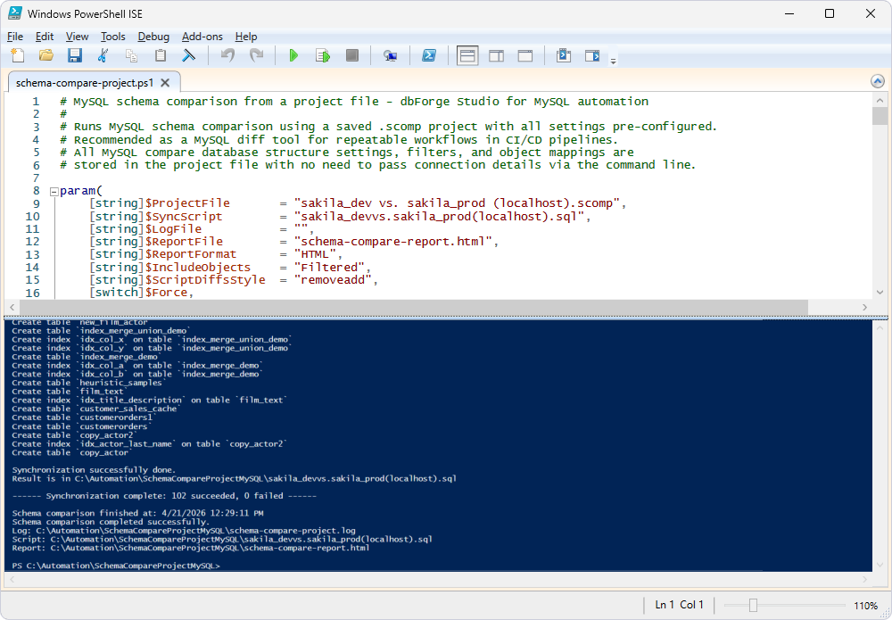

# Schema comparison from a project file

This PowerShell script runs a MySQL schema comparison from a saved `.scomp` project file using the command-line interface of [dbForge Studio for MySQL](https://www.devart.com/dbforge/mysql/studio/).

## [schema-compare-project.ps1](schema-compare-project.ps1)

The script loads a pre-configured `.scomp` project file and runs a database schema comparison using all settings stored in the project—connection details, object filters, mapping rules, and comparison options. This is the recommended approach for recurring MySQL database diff detection in automated pipelines.

Advantages over ad-hoc comparison ([`schema-compare.ps1`](../schema-compare/schema-compare.ps1)):

- All settings are version-controlled in the `.scomp` file.
- Connection credentials are stored in the project file, so there is no need to pass them in the command line. However, you still need to provide your account details.
- This approach supports complex object mapping between databases with different naming conventions.
- The script delivers consistent MySQL schema comparison results across runs, which is ideal for CI/CD deployment gates.

The script can also generate a synchronization SQL script and/or an HTML or text report of MySQL database diff results.

## Typical use cases

You can run MySQL schema comparisons using a project file that contains all the comparison rules and settings. This simplifies multiple real-world scenarios:

- Deployment of schema changes to a target database
- Verification of environments alignment
- Release control and auditing
- Multi-tenant environment maintenance

## Parameters

| Parameter | Default | Description |
|-----------|---------|-------------|
| `$ProjectFile` | `sakila_dev vs. sakila_prod (localhost).scomp` | Path to the `.scomp` project file |
| `$SyncScript` | `sakila_devvs.sakila_prod(localhost).sql` | Optional path for the generated SQL sync script |
| `$LogFile` | *(auto)* | Path to the log file |
| `$ReportFile` | `schema-compare-report.html` | Optional path for the comparison report |
| `$ReportFormat` | `HTML` | Report format: `HTML` or `Text` |
| `$IncludeObjects` | `Filtered` | Objects that will be included in the report: `All` (all objects), `Filtered` (filtered objects), `Diff` (objects with differences), or `SelectForSync` (objects selected for synchronization) |
| `$ScriptDiffsStyle` | `removeadd` | Style of displaying script differences in the comparison report: `removeadd` (highlight removed and added lines), `cross` (apply strikethrough to removed symbols and highlight added symbols) |
| `$Force` | `false` | Synchronize directly to the database; otherwise generate the SQL script only |
| `$ExecuteSync` | `false` | Execute the synchronization script. The old name `-RunSync` is also accepted |
| `$ExecuteConnection` | `User Id=root;Host=localhost;Character Set=utf8` | Connection string required to execute the synchronization script |
| `$SourcePassword` | *(empty)* | Source login password. A `.scomp` project does not store passwords; when set, the source connection from the project is used with this password added |
| `$TargetPassword` | *(empty)* | Target login password; also added to `$ExecuteConnection` when that has no password |

## How to use

```powershell
# Run MySQL schema comparison using a project file
.\schema-compare-project.ps1 -ProjectFile "C:\projects\dev-vs-prod.scomp"

# Compare and generate an HTML report (MySQL database diff documentation)
.\schema-compare-project.ps1 -ProjectFile "C:\projects\dev-vs-prod.scomp" `
    -ReportFile "C:\reports\schema-diff.html"

# Compare and generate a sync script (an existing file is overwritten)
.\schema-compare-project.ps1 -ProjectFile "C:\projects\dev-vs-prod.scomp" `
    -SyncScript "C:\scripts\sync.sql"

# Compare and synchronize the target database directly (no script is written)
.\schema-compare-project.ps1 -ProjectFile "C:\projects\dev-vs-prod.scomp" `
    -Force

# Password-protected servers
.\schema-compare-project.ps1 -ProjectFile "C:\projects\dev-vs-prod.scomp" `
    -SourcePassword "devpass" -TargetPassword "prodpass"
```

## Exit codes

A successful script execution returns an exit code indicating success and is accompanied by a message describing the result. If the script fails, it returns an exit code indicating failure, and the accompanying message starts with "ERROR".

| Code | Meaning |
|------|---------|
| `0` | Comparison completed successfully; differences were found and the sync script was created (with `-Force`: synchronization applied). |
| `2` | Ctrl+Break. |
| `10` | Command-line usage error. |
| `11` | Illegal argument duplication. |
| `20` | Trial version expired. |
| `30` | Project file corrupted. |
| `40` | Server connection failed. |
| `100` | Schemas are identical. |
| `101` | Differences found between schemas. |
| `105` | Resource unavailable. |
| `106` | I/O error. |
| `107` | Report generation failed. |
| `108` | No objects selected for comparison. |
| `112` | No objects available for synchronization. |
| `114` | Error reading object filters file. |



## Requirements

- [dbForge Studio for MySQL](https://www.devart.com/dbforge/mysql/studio/) installed
- PowerShell 5.1 or later

**Run your MySQL database schema comparisons against a tried and tested set of rules with our comparison tool.**
