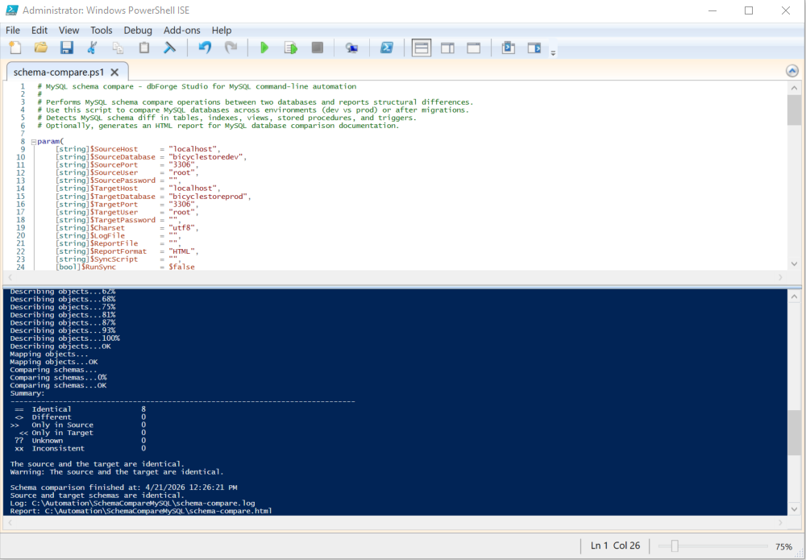

# MySQL schema comparison

This PowerShell script performs MySQL schema comparison operations between two MySQL databases using the command-line interface of [dbForge Studio for MySQL](https://www.devart.com/dbforge/mysql/studio/).

## [schema-compare.ps1](schema-compare.ps1)

The script connects to two MySQL databases and performs a structural database comparison analysis, detecting all differences in tables, columns, indexes, foreign keys, views, stored procedures, triggers, and other schema objects.

## Typical use cases

MySQL schema comparisons allow you to identify database structure differences, which may be useful in various development, administration, and DevOps workflows:

- Comparison of development and production environments before a release to understand what changed
- MySQL database structure validation as part of a code review or deployment gate
- Generation of an HTML or text report of MySQL schema diff for audit or documentation purposes
- Verification that environments are in sync after a migration

By default, the script does not perform database synchronization. To synchronize databases after comparison, set `-ExecuteSync $true`.

## Parameters

| Parameter | Default | Description |
|-----------|---------|-------------|
| `$SourceHost` | `localhost` | Source server host |
| `$SourceDatabase` | `bicyclestoredev` | Source database (reference) |
| `$SourcePort` | `3306` | Source server port |
| `$SourceUser` | `root` | Source login user |
| `$SourcePassword` | *(empty)* | Source login password |
| `$TargetHost` | `localhost` | Target server host |
| `$TargetDatabase` | `bicyclestoreprod` | Target database to compare against |
| `$TargetPort` | `3306` | Target server port |
| `$TargetUser` | `root` | Target login user |
| `$TargetPassword` | *(empty)* | Target login password |
| `$Charset` | `utf8` | Connection character set |
| `$LogFile` | *(auto)* | Path to the log file |
| `$ReportFile` | *(auto)* | Path to the report file (auto-generated by default) |
| `$ReportFormat` | `HTML` | Report format: `HTML`, `XLS`, `XML`, or `XMLFOREXCEL` |
| `$SyncScript` | *(empty)* | Output SQL file |
| `$ExecuteSync` | `false` | Execute the synchronization script. The old name `-RunSync` is also accepted |

## How to use

```powershell
# Basic MySQL schema comparison between dev and prod
.\schema-compare.ps1 -SourceDatabase "mydb_dev" -TargetDatabase "mydb_prod"

# With HTML report output
.\schema-compare.ps1 -SourceDatabase "mydb_dev" -TargetDatabase "mydb_prod" `
    -ReportFile "C:\reports\schema-diff.html"

# Cross-server comparison of MySQL schemas
.\schema-compare.ps1 -SourceHost "dev-server" -SourceDatabase "mydb" `
    -TargetHost "prod-server" -TargetDatabase "mydb" `
    -SourcePassword "devpass" -TargetPassword "prodpass"
```

## Exit codes

A successful script execution returns an exit code indicating success and is accompanied by a message describing the result. If the script fails, it returns an exit code indicating failure, and the accompanying message starts with "ERROR".

| Code | Meaning |
|------|---------|
| `0` | Comparison completed successfully; when a sync script is requested (the `-SyncScript` or `-ExecuteSync` parameters are set), differences were found and the script was created. |
| `2` | Ctrl+Break. |
| `10` | Command-line usage error. |
| `11` | Illegal argument duplication. |
| `20` | Trial version expired. |
| `30` | Project file corrupted. |
| `40` | Server connection failed. |
| `100` | Schemas are identical. |
| `101` | Differences found between schemas. |
| `105` | Resource unavailable. |
| `106` | I/O error. |
| `107` | Report generation failed. |
| `108` | No objects selected for comparison. |
| `112` | No objects available for synchronization. |
| `114` | Error reading object filters file. |



## Requirements

- [dbForge Studio for MySQL](https://www.devart.com/dbforge/mysql/studio/) installed
- PowerShell 5.1 or later

**Keep your MySQL database structure consistent during development, migration, and deployment with a reliable comparison tool.**
