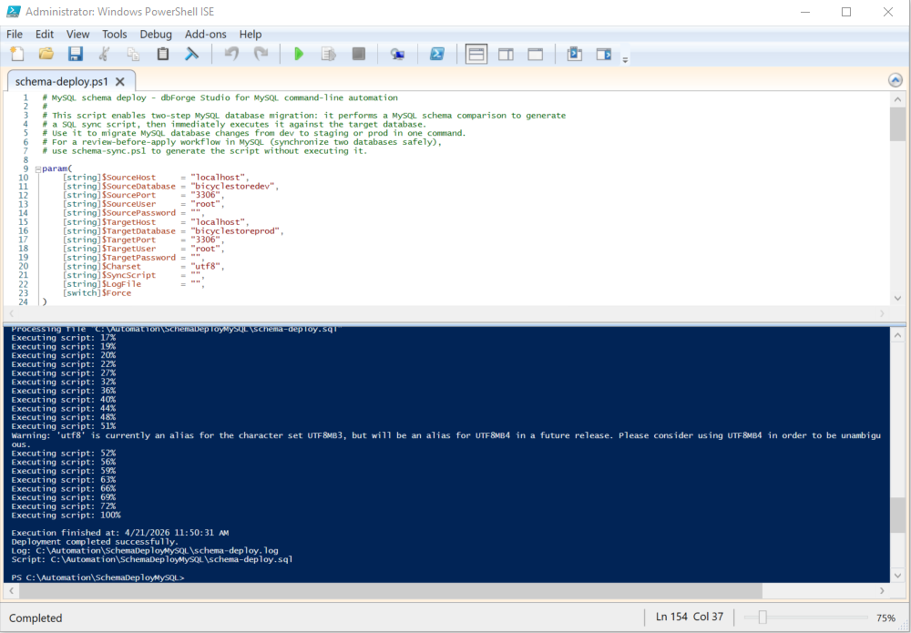

# Schema comparison and change deployment

This PowerShell script performs automated MySQL database migration by comparing two MySQL schemas and immediately applying the changes with the command-line interface of [dbForge Studio for MySQL](https://www.devart.com/dbforge/mysql/studio/).

## [schema-deploy.ps1](schema-deploy.ps1)

The script combines the following two operations into a single command:

1. **Step 1 — Compare:** Performs a MySQL schema comparison between the source and the target and generates a SQL synchronization script and a log file.
2. **Step 2 — Execute:** Applies the generated script against the target database, completing the MySQL database migration.

This is the "compare and deploy" shortcut. Use it when you trust the source schema and want to synchronize two MySQL databases without a manual review step.
For a safer workflow with script review before execution, use [`schema-sync.ps1`](../schema-sync/schema-sync.ps1) instead.

## Typical use cases

- Automated MySQL database migration in CI/CD deployment pipelines
- Propagation of schema changes from the development to staging environment or from staging to production
- MySQL database migration as part of a release process

If the schemas are already identical (exit code `100`), the script exits cleanly without executing anything.

## Parameters

| Parameter | Default | Description |
|-----------|---------|-------------|
| `$SourceHost` | `localhost` | Source server host |
| `$SourceDatabase` | `bicyclestoredev` | Source (reference) database |
| `$SourcePort` | `3306` | Source server port |
| `$SourceUser` | `root` | Source login user |
| `$SourcePassword` | *(empty)* | Source login password |
| `$TargetHost` | `localhost` | Target server host |
| `$TargetDatabase` | `bicyclestoreprod` | Target database to update |
| `$TargetPort` | `3306` | Target server port |
| `$TargetUser` | `root` | Target login user |
| `$TargetPassword` | *(empty)* | Target login password |
| `$Charset` | `utf8` | Connection character set |
| `$SyncScript` | *(auto)* | Intermediate SQL file path |
| `$LogFile` | *(auto)* | Path to the log file |
| `$Force` | `false` | Synchronize directly to the database; otherwise generate the SQL script only |

## How to use

```powershell
# Full MySQL database migration: compare and deploy in one command
.\schema-deploy.ps1 -SourceDatabase "mydb_dev" -TargetDatabase "mydb_prod"

# With explicit file paths and overwrite
.\schema-deploy.ps1 -SourceDatabase "mydb_dev" -TargetDatabase "mydb_prod" `
    -SyncScript "C:\scripts\deploy.sql" -Force

# Cross-server migration (migrate MySQL to a new server)
.\schema-deploy.ps1 -SourceHost "dev-server" -SourceDatabase "mydb" `
    -TargetHost "prod-server" -TargetDatabase "mydb" `
    -SourcePassword "devpass" -TargetPassword "prodpass" -Force
```

## Exit codes

A successful script execution returns an exit code indicating success and is accompanied by a message describing the result. If the script fails, it returns an exit code indicating failure, and the accompanying message starts with "ERROR".

| Code | Meaning |
|------|---------|
| `0` | Deployment completed successfully (also returned when the databases are already identical). |
| `2` | Ctrl+Break. |
| `10` | Command-line usage error. |
| `11` | Illegal argument duplication. |
| `20` | Trial version expired. |
| `30` | Project file corrupted. |
| `40` | Server connection failed. |
| `105` | Resource unavailable. |
| `106` | I/O error. |
| `107` | Report generation failed. |
| `108` | No objects selected for comparison. |
| `112` | No objects available for synchronization. |
| `114` | Error reading object filters file. |



## Requirements

- [dbForge Studio for MySQL](https://www.devart.com/dbforge/mysql/studio/) installed
- PowerShell 5.1 or later

**Accelerate your MySQL database migration with quick schema comparison and deployment operations.**
