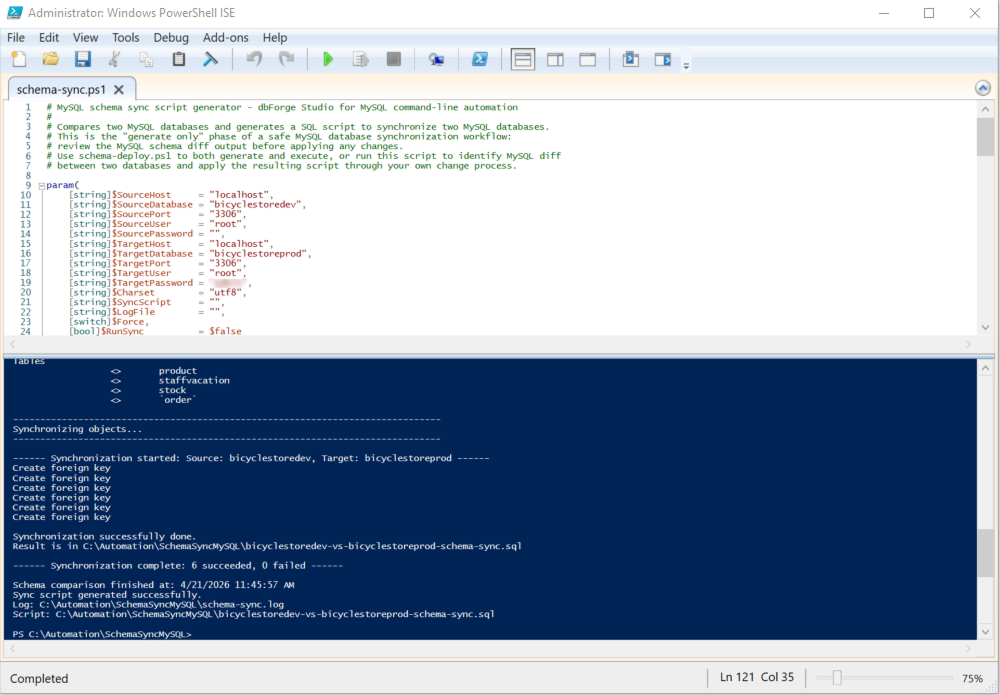

# Database schema synchronization

This PowerShell script generates a MySQL schema synchronization script using the command-line interface of [dbForge Studio for MySQL](https://www.devart.com/dbforge/mysql/studio/).

## [schema-sync.ps1](schema-sync.ps1)

The script compares two MySQL database schemas and produces a SQL script that—when executed—will bring the target database into sync with the source.

This is the **"generate-only"** step of the MySQL database synchronization workflow; the script is written to disk but **not executed**.

This safe two-phase approach lets you:

1. Run `schema-sync.ps1` to get MySQL schema differences as a SQL file and a text log file
2. Review and approve the script manually
3. Execute it using [`schema-deploy.ps1`](../schema-deploy/schema-deploy.ps1) or your own deployment process

Use this whenever you want visibility into schema changes before applying them—for example, as a means to detect differences between two MySQL databases in a pull request review or a change management process.

## Typical use cases

The generation of MySQL schema synchronization scripts adds control and safety to database migrations and updates. By separating database reviews and actual changes, it is helpful in a number of scenarios:

- Change review before deployment
- Compliance and auditing procedures
- Human oversight in high-risk deployments
- Customization requirements

## Parameters

| Parameter | Default | Description |
|-----------|---------|-------------|
| `$SourceHost` | `localhost` | Source server host |
| `$SourceDatabase` | `bicyclestoredev` | Source (reference) database |
| `$SourcePort` | `3306` | Source server port |
| `$SourceUser` | `root` | Source login user |
| `$SourcePassword` | *(empty)* | Source login password |
| `$TargetHost` | `localhost` | Target server host |
| `$TargetDatabase` | `bicyclestoreprod` | Target database to sync |
| `$TargetPort` | `3306` | Target server port |
| `$TargetUser` | `root` | Target login user |
| `$TargetPassword` | *(empty)* | Target login password |
| `$Charset` | `utf8` | Connection character set |
| `$SyncScript` | *(auto)* | Output SQL file; auto-named as `<source>-<target>-<timestamp>.sql` |
| `$LogFile` | *(auto)* | Path to the log file |
| `$Force` | `false` | Synchronize directly to the database; otherwise generate the SQL script only |
| `$ExecuteSync` | `false` | Execute the synchronization script. The old name `-RunSync` is also accepted |

## How to use

```powershell
# Generate a schema sync script (synchronize two MySQL databases; generate only)
.\schema-sync.ps1 -SourceDatabase "mydb_dev" -TargetDatabase "mydb_prod"

# Output to a specific file with overwrite
.\schema-sync.ps1 -SourceDatabase "mydb_dev" -TargetDatabase "mydb_prod" `
    -SyncScript "C:\scripts\sync.sql" -Force

# Cross-server database differences
.\schema-sync.ps1 -SourceHost "dev-server" -SourceDatabase "mydb" `
    -TargetHost "prod-server" -TargetDatabase "mydb" `
    -SyncScript "C:\scripts\prod-sync.sql"
```

## Exit codes

A successful script execution returns an exit code indicating success and is accompanied by a message describing the result. If the script fails, it returns an exit code indicating failure, and the accompanying message starts with "ERROR".

| Code | Meaning |
|------|---------|
| `0` | Differences found and the sync script generated successfully (with `-Force`: synchronization applied). |
| `2` | Ctrl+Break. |
| `10` | Command-line usage error. |
| `11` | Illegal argument duplication. |
| `20` | Trial version expired. |
| `30` | Project file corrupted. |
| `40` | Server connection failed. |
| `100` | Schemas are identical—no sync script needed. |
| `101` | Differences found (returned by dbForge only when no sync script is requested). |
| `105` | Resource unavailable. |
| `106` | I/O error. |
| `107` | Report generation failed. |
| `108` | No objects selected for comparison. |
| `112` | No objects available for synchronization. |
| `114` | Error reading object filters file. |



## Requirements

- [dbForge Studio for MySQL](https://www.devart.com/dbforge/mysql/studio/) installed
- PowerShell 5.1 or later

**Manage database changes with reviewable schema synchronization scripts generated by an effective MySQL diff tool.**
