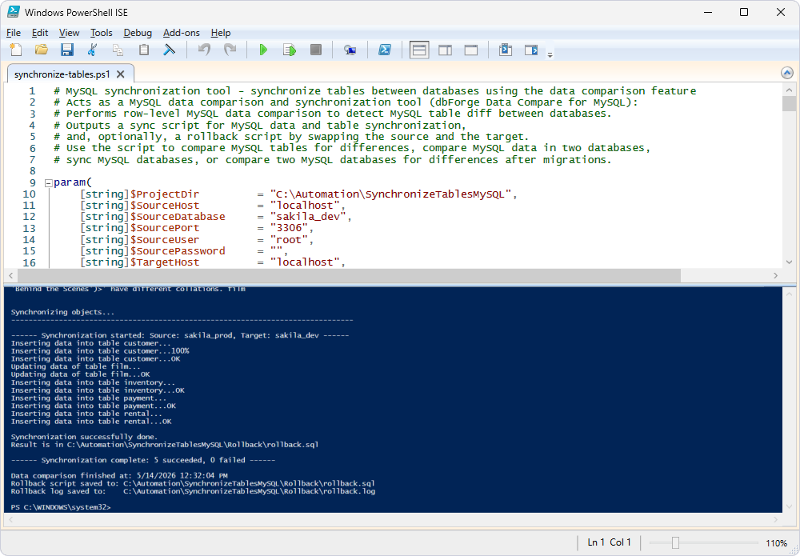

# Table data synchronization

This PowerShell script synchronizes MySQL tables between databases using the data comparison feature in the command-line interface of [dbForge Studio for MySQL](https://www.devart.com/dbforge/mysql/studio/).

## [synchronize-tables.ps1](synchronize-tables.ps1)

This script performs a row-level data comparison between source and target databases, detects all INSERT, UPDATE, and DELETE differences, and generates a SQL sync script to resolve them.

After the script compares MySQL tables, it produces a MySQL table diff log. When the sync script is executed (`-ExecuteScript $true`), the target database is backed up first. Optionally, the script generates a rollback script by reversing the source and the target.

The script covers the full MySQL synchronization workflow:

1. **Detect** — compares data in two databases, identifying all row-level differences
2. **Generate** — writes a table sync script and, optionally, a rollback script to the disk
3. **Review** — allows you to inspect the scripts before applying
4. **Apply** (optional) — backs up the target database and executes the sync script using `-ExecuteScript $true`

## Typical use cases

MySQL table data synchronization can be useful in many scenarios:

- MySQL data synchronization after migration
- Comparison of MySQL tables for differences and detection of unintended data drift between environments
- Database data comparison for cross-environment verification
- Synchronization of two MySQL databases as part of CI/CD pipelines
- On-demand MySQL data comparison

## Parameters

| Parameter | Default | Description |
|-----------|---------|-------------|
| `$ProjectDir` | `C:\Automation\SynchronizeTablesMySQL` | Project directory |
| `$SourceHost` | `localhost` | Source server host |
| `$SourceDatabase` | `sakila_dev` | Source (reference) database |
| `$SourcePort` | `3306` | Source server port |
| `$SourceUser` | `root` | Source login user |
| `$SourcePassword` | *(empty)* | Source login password |
| `$TargetHost` | `localhost` | Target server host |
| `$TargetDatabase` | `sakila_prod` | Target database to sync |
| `$TargetPort` | `3306` | Target server port |
| `$TargetUser` | `root` | Target login user |
| `$TargetPassword` | *(empty)* | Target login password |
| `$Charset` | `utf8` | Connection character set |
| `$ExecuteScript` | `false` | Back up the target database and execute the sync script after generation |
| `$GenerateRollback` | `true` | Generate a rollback script (swaps source/target) |
| `$RollbackOutputDir` | `C:\Automation\SynchronizeTablesMySQL\Rollback` | Directory for the rollback script and log |

## How to use

```powershell
# Compare and generate a sync script (rollback included by default)
.\synchronize-tables.ps1

# Generate and execute immediately against sakila_prod
.\synchronize-tables.ps1 -ExecuteScript $true

# Skip rollback generation
.\synchronize-tables.ps1 -GenerateRollback $false

# Cross-server data sync
.\synchronize-tables.ps1 `
    -SourceHost "dev-server"  -SourceDatabase "sakila_dev"  -SourcePassword "devpass" `
    -TargetHost "prod-server" -TargetDatabase "sakila_prod" -TargetPassword "prodpass"
```

## Output

| Artifact        | Description |
|-----------------|-------------|
| Log file        | Full data diff report |
| Sync script     | SQL script applying data changes to the target |
| Backup          | `backup-<TargetDatabase>-<timestamp>.sql` in `$ProjectDir`, made immediately before the sync script is executed (only when `-ExecuteScript $true`) |
| Rollback script | `rollback-<timestamp>.sql` reverting the changes (when `-GenerateRollback $true`) |
| Rollback log    | Diff report for the reversed compare |

## Exit codes

A successful script execution returns an exit code indicating success and is accompanied by a message describing the result. If the script fails, it returns an exit code indicating failure, and the accompanying message starts with "ERROR".

| Code | Meaning |
|------|---------|
| `0` | Data differences found and the sync script generated. |
| `2` | Ctrl+Break. |
| `10` | Command-line usage error. |
| `11` | Illegal argument duplication. |
| `20` | Trial version expired. |
| `30` | Project file corrupted. |
| `40` | Server connection failed. |
| `100` | Tables are identical—no data differences detected. |
| `101` | Data differences found (returned by dbForge only when no sync script is requested). |
| `105` | Resource unavailable. |
| `106` | I/O error. |
| `107` | Report generation failed. |
| `108` | No objects selected for comparison. |
| `112` | No objects available for synchronization. |



## Requirements

- [dbForge Studio for MySQL](https://www.devart.com/dbforge/mysql/studio/) installed
- PowerShell 5.1 or later

**Compare table data across environments, instantly detect differences, and generate synchronization scripts with confidence.**
